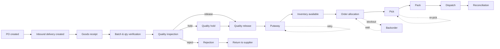

# As-Is Process Map (observed)

> **Synthetic data disclaimer:** Nordvale Pharmaceuticals, all records, results and costs are fictional. No Merck systems or data were accessed. This is process design, not SAP configuration.

**Observed pain points (from data):** inbound deviation rate 6.5%, outbound 3.7%; rework rate 6.8%; supplier OTD 74.1%; receiving-to-putaway 35.3 h; quality hold 60.3 h; stockout rate 13.1%.

**Largest internal handover waits (inbound):**

| activity | next_activity | count | mean_h | p90_h | share_of_total_wait |
|---|---|---|---|---|---|
| Quality Inspection | Quality Release | 2663 | 11.417 | 23.607 | 0.260 |
| Quality Release | Putaway | 3020 | 8.656 | 16.629 | 0.223 |
| Quality Hold | Quality Release | 367 | 60.162 | 116.182 | 0.188 |
| Batch & Quantity Verification | Quality Inspection | 3115 | 4.506 | 7.472 | 0.120 |
| Goods Receipt | Batch & Quantity Verification | 3144 | 3.360 | 5.638 | 0.090 |

