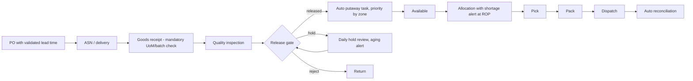

# To-Be Process Map (proposed design)

> **Synthetic data disclaimer:** Nordvale Pharmaceuticals, all records, results and costs are fictional. No Merck systems or data were accessed. This is process design, not SAP configuration.

**Design changes:** system-enforced status gate (no putaway before release); mandatory verification step; master-data validation at creation; hold aging alerts; replenishment parameter review; FEFO picking and near-expiry alerts.
